# NSImage 標準画像一覧

生成環境：Xcode 27.2 / Build version 27B52、macOS 27.2。

選択中のSDKの`NSImage.h`に宣言された画像名定数を掲載しています。シンボル名はSwiftで参照する名前です。SF Symbolsの名前ではありません。説明は用途を日本語で整理したものです。

PNGは96 × 96ピクセルの白背景に、縦横比を保って最大64 × 64ピクセルで描画しています。テンプレート画像は黒で描画しています。実際のコントロールでの色・外観とは異なります。Touch Bar用画像は本来Touch Barで使う画像です。アプリアイコンは書き出しプロセスの実行環境に依存します。

## Swiftでの利用例

表のシンボル名を`NSImage(named:)`に渡して取得します。画像が取得できない場合に備えて、オプショナルを処理してください。

### SwiftUIで表示する

```swift
import AppKit
import SwiftUI

struct AddImageView: View {
    var body: some View {
        if let image = NSImage(named: NSImage.addTemplateName) {
            Image(nsImage: image)
                .resizable()
                .scaledToFit()
                .frame(width: 24, height: 24)
                .accessibilityLabel("追加")
        } else {
            Text("画像を取得できません")
        }
    }
}
```

### AppKitのボタンに設定する

```swift
import AppKit

let button = NSButton(title: "追加", target: nil, action: nil)
button.image = NSImage(named: NSImage.addTemplateName)
button.imagePosition = .imageLeading
```

ステータス画像なども同じ方法で取得できます。

```swift
let availableImage = NSImage(named: NSImage.statusAvailableName)
```

Touch Bar用の画像も取得方法は同じですが、本来は`NSTouchBar`内で利用する画像です。このサンプルアプリでは画像一覧の確認用に表示しています。

## 一般用の標準画像

|画像|シンボル名|説明|
|---|---|---|
|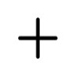|`NSImage.addTemplateName`|項目を追加|
|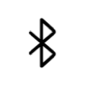|`NSImage.bluetoothTemplateName`|Bluetooth|
||`NSImage.bonjourName`|Bonjourによるサービス検出|
||`NSImage.bookmarksTemplateName`|ブックマーク|
||`NSImage.cautionName`|注意・警告|
|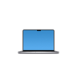|`NSImage.computerName`|コンピュータ|
||`NSImage.enterFullScreenTemplateName`|フルスクリーンを開始|
||`NSImage.exitFullScreenTemplateName`|フルスクリーンを解除|
||`NSImage.folderName`|フォルダ|
||`NSImage.folderBurnableName`|ディスク作成用フォルダ|
||`NSImage.folderSmartName`|スマートフォルダ|
|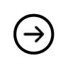|`NSImage.followLinkFreestandingTemplateName`|リンク先へ移動（枠なしボタン向け）|
|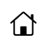|`NSImage.homeTemplateName`|ホーム|
||`NSImage.iChatTheaterTemplateName`|旧iChat Theater|
||`NSImage.lockLockedTemplateName`|施錠|
|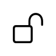|`NSImage.lockUnlockedTemplateName`|解錠|
||`NSImage.networkName`|ネットワーク|
||`NSImage.pathTemplateName`|パス|
|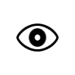|`NSImage.quickLookTemplateName`|クイックルック|
||`NSImage.refreshFreestandingTemplateName`|更新（枠なしボタン向け）|
|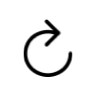|`NSImage.refreshTemplateName`|更新|
||`NSImage.removeTemplateName`|項目を削除|
||`NSImage.revealFreestandingTemplateName`|対象を表示（枠なしボタン向け）|
|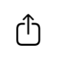|`NSImage.shareTemplateName`|共有|
||`NSImage.slideshowTemplateName`|スライドショー|
||`NSImage.statusAvailableName`|利用可能（緑）|
||`NSImage.statusNoneName`|状態なし（グレー）|
||`NSImage.statusPartiallyAvailableName`|一部利用可能（黄）|
||`NSImage.statusUnavailableName`|利用不可（赤）|
||`NSImage.stopProgressFreestandingTemplateName`|処理を停止（枠なしボタン向け）|
|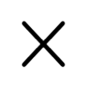|`NSImage.stopProgressTemplateName`|処理を停止|
|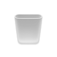|`NSImage.trashEmptyName`|空のゴミ箱|
|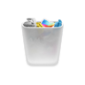|`NSImage.trashFullName`|中身のあるゴミ箱|
|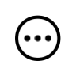|`NSImage.actionTemplateName`|アクションメニュー|
|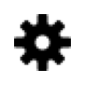|`NSImage.smartBadgeTemplateName`|スマート項目のバッジ|
|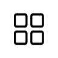|`NSImage.iconViewTemplateName`|アイコン表示|
||`NSImage.listViewTemplateName`|リスト表示|
|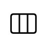|`NSImage.columnViewTemplateName`|カラム表示|
|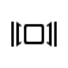|`NSImage.flowViewTemplateName`|カバーフロー表示|
||`NSImage.invalidDataFreestandingTemplateName`|入力データの不備を表示|
||`NSImage.goForwardTemplateName`|進む（UIの配置方向に対応）|
||`NSImage.goBackTemplateName`|戻る（UIの配置方向に対応）|
||`NSImage.goRightTemplateName`|右へ移動（方向固定）|
||`NSImage.goLeftTemplateName`|左へ移動（方向固定）|
||`NSImage.rightFacingTriangleTemplateName`|右向きの三角形|
||`NSImage.leftFacingTriangleTemplateName`|左向きの三角形|
||`NSImage.Name("NSDotMac")`|旧.Mac（非推奨、MobileMeと同じ画像。Swiftの静的定数がないため名前文字列で指定）|
||`NSImage.mobileMeName`|旧MobileMe|
||`NSImage.multipleDocumentsName`|複数書類のドラッグ表示|
||`NSImage.userAccountsName`|ユーザアカウント設定|
|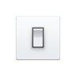|`NSImage.preferencesGeneralName`|一般設定|
||`NSImage.advancedName`|詳細設定|
||`NSImage.infoName`|情報|
||`NSImage.fontPanelName`|フォントパネル|
|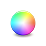|`NSImage.colorPanelName`|カラーパネル|
||`NSImage.userName`|ユーザ|
||`NSImage.userGroupName`|ユーザグループ|
||`NSImage.everyoneName`|全ユーザ|
||`NSImage.userGuestName`|ゲストユーザ|
||`NSImage.menuOnStateTemplateName`|メニューの選択状態（メニュー用）|
||`NSImage.menuMixedStateTemplateName`|メニューの混在状態（メニュー用）|
||`NSImage.applicationIconName`|実行中アプリのアイコン|
## Touch Bar用の標準画像

|画像|シンボル名|説明|
|---|---|---|
|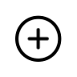|`NSImage.touchBarAddDetailTemplateName`|詳細を追加|
||`NSImage.touchBarAddTemplateName`|項目を追加|
|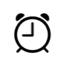|`NSImage.touchBarAlarmTemplateName`|アラーム|
|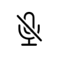|`NSImage.touchBarAudioInputMuteTemplateName`|マイクをミュート|
|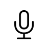|`NSImage.touchBarAudioInputTemplateName`|音声入力|
||`NSImage.touchBarAudioOutputMuteTemplateName`|音声出力をミュート|
|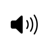|`NSImage.touchBarAudioOutputVolumeHighTemplateName`|音量：大|
||`NSImage.touchBarAudioOutputVolumeLowTemplateName`|音量：小|
|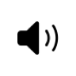|`NSImage.touchBarAudioOutputVolumeMediumTemplateName`|音量：中|
||`NSImage.touchBarAudioOutputVolumeOffTemplateName`|音量：オフ|
||`NSImage.touchBarBookmarksTemplateName`|ブックマーク|
||`NSImage.touchBarColorPickerFillName`|塗りの色を選択|
||`NSImage.touchBarColorPickerFontName`|文字の色を選択|
||`NSImage.touchBarColorPickerStrokeName`|線の色を選択|
||`NSImage.touchBarCommunicationAudioTemplateName`|音声通話|
||`NSImage.touchBarCommunicationVideoTemplateName`|ビデオ通話|
|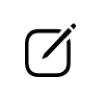|`NSImage.touchBarComposeTemplateName`|作成・編集|
||`NSImage.touchBarDeleteTemplateName`|削除|
|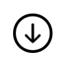|`NSImage.touchBarDownloadTemplateName`|ダウンロード|
|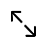|`NSImage.touchBarEnterFullScreenTemplateName`|フルスクリーンを開始|
|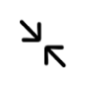|`NSImage.touchBarExitFullScreenTemplateName`|フルスクリーンを解除|
||`NSImage.touchBarFastForwardTemplateName`|早送り|
||`NSImage.touchBarFolderCopyToTemplateName`|フォルダへコピー|
||`NSImage.touchBarFolderMoveToTemplateName`|フォルダへ移動|
||`NSImage.touchBarFolderTemplateName`|フォルダ|
|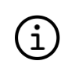|`NSImage.touchBarGetInfoTemplateName`|情報を見る|
|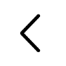|`NSImage.touchBarGoBackTemplateName`|戻る|
||`NSImage.touchBarGoDownTemplateName`|下へ移動|
|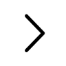|`NSImage.touchBarGoForwardTemplateName`|進む|
|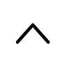|`NSImage.touchBarGoUpTemplateName`|上へ移動|
|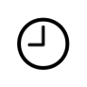|`NSImage.touchBarHistoryTemplateName`|履歴|
||`NSImage.touchBarIconViewTemplateName`|アイコン表示|
||`NSImage.touchBarListViewTemplateName`|リスト表示|
||`NSImage.touchBarMailTemplateName`|メール|
||`NSImage.touchBarNewFolderTemplateName`|新規フォルダ|
|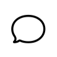|`NSImage.touchBarNewMessageTemplateName`|新規メッセージ|
|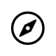|`NSImage.touchBarOpenInBrowserTemplateName`|ブラウザで開く|
||`NSImage.touchBarPauseTemplateName`|一時停止|
||`NSImage.touchBarPlayPauseTemplateName`|再生・一時停止|
||`NSImage.touchBarPlayTemplateName`|再生|
||`NSImage.touchBarQuickLookTemplateName`|クイックルック|
|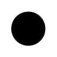|`NSImage.touchBarRecordStartTemplateName`|録音を開始|
||`NSImage.touchBarRecordStopTemplateName`|録音を停止|
||`NSImage.touchBarRefreshTemplateName`|更新|
||`NSImage.touchBarRemoveTemplateName`|項目を削除|
||`NSImage.touchBarRewindTemplateName`|巻き戻し|
|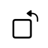|`NSImage.touchBarRotateLeftTemplateName`|左へ回転|
|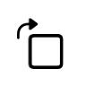|`NSImage.touchBarRotateRightTemplateName`|右へ回転|
|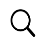|`NSImage.touchBarSearchTemplateName`|検索|
||`NSImage.touchBarShareTemplateName`|共有|
|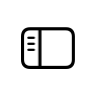|`NSImage.touchBarSidebarTemplateName`|サイドバー|
|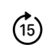|`NSImage.touchBarSkipAhead15SecondsTemplateName`|15秒先へ移動|
|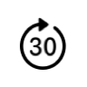|`NSImage.touchBarSkipAhead30SecondsTemplateName`|30秒先へ移動|
||`NSImage.touchBarSkipAheadTemplateName`|先へスキップ|
|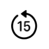|`NSImage.touchBarSkipBack15SecondsTemplateName`|15秒前へ移動|
|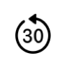|`NSImage.touchBarSkipBack30SecondsTemplateName`|30秒前へ移動|
||`NSImage.touchBarSkipBackTemplateName`|前へスキップ|
||`NSImage.touchBarSkipToEndTemplateName`|末尾へ移動|
||`NSImage.touchBarSkipToStartTemplateName`|先頭へ移動|
||`NSImage.touchBarSlideshowTemplateName`|スライドショー|
|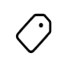|`NSImage.touchBarTagIconTemplateName`|タグ|
||`NSImage.touchBarTextBoldTemplateName`|太字|
||`NSImage.touchBarTextBoxTemplateName`|テキストボックス|
||`NSImage.touchBarTextCenterAlignTemplateName`|中央揃え|
|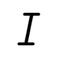|`NSImage.touchBarTextItalicTemplateName`|斜体|
||`NSImage.touchBarTextJustifiedAlignTemplateName`|両端揃え|
||`NSImage.touchBarTextLeftAlignTemplateName`|左揃え|
||`NSImage.touchBarTextListTemplateName`|リスト|
||`NSImage.touchBarTextRightAlignTemplateName`|右揃え|
|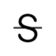|`NSImage.touchBarTextStrikethroughTemplateName`|取り消し線|
||`NSImage.touchBarTextUnderlineTemplateName`|下線|
|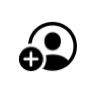|`NSImage.touchBarUserAddTemplateName`|ユーザを追加|
||`NSImage.touchBarUserGroupTemplateName`|ユーザグループ|
||`NSImage.touchBarUserTemplateName`|ユーザ|
|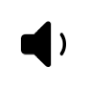|`NSImage.touchBarVolumeDownTemplateName`|音量を下げる|
||`NSImage.touchBarVolumeUpTemplateName`|音量を上げる|
||`NSImage.touchBarPlayheadTemplateName`|再生位置|

保存結果：139 / 139件。

再生成：プロジェクトディレクトリで`python3 scripts/export_images.py`を実行します。

## iOSの定義済み標準画像（UIImage）

iOSではAppKitの`NSImage`ではなく、UIKitの`UIImage`を使います。UIImageにも、文字列の画像名を指定せずに取得できる定義済み標準画像があります。

### 定義済み画像の一覧

| シンボル名 | 説明 |
| --- | --- |
| `UIImage.add` | コンテンツの追加 |
| `UIImage.remove` | コンテンツの削除 |
| `UIImage.actions` | ユーザが実行するアクション |
| `UIImage.checkmark` | 塗りつぶされた円背景のチェックマーク |
| `UIImage.strokedCheckmark` | 色付きの円と白い縁取りのチェックマーク |

これらはすべてiOS 13以降で利用できる型プロパティで、戻り値は非オプショナルの`UIImage`です。

### iOSアプリでの表示例

以下は提供されたスクリーンショットです。上から`UIImage.add`、`UIImage.remove`、`UIImage.actions`、`UIImage.checkmark`、`UIImage.strokedCheckmark`の順に表示されています。個別の画像を書き出したものではなく、5種類を一覧表示した画面です。色や外観は表示環境・設定により変わる場合があります。


### SwiftUIで表示する

```swift
import SwiftUI
import UIKit

struct AddImageView: View {
    var body: some View {
        Image(uiImage: .add)
            .accessibilityLabel("追加")
    }
}
```

### UIKitのボタンで使用する

```swift
import UIKit

let button = UIButton(type: .system)
button.setImage(.add, for: .normal)
button.accessibilityLabel = "追加"

// 画像単体でも取得できます。
let image: UIImage = .checkmark
```

### SF Symbolsとの使い分け

上記5種類は、標準の用途に対応した画像を型プロパティで取得するAPIです。より幅広いアイコンを選ぶ場合は、SF Symbolsを名前で取得できます。こちらの戻り値はオプショナルです。

```swift
// UIKit
let folderImage = UIImage(systemName: "folder")

// SwiftUI（macOS・iOS共通）
Image(systemName: "folder")
```

AppKitの`NSImage.addTemplateName`はUIKitの画像名ではありません。iOSで追加を表したい場合は、`UIImage.add`やSF Symbolsの`"plus"`などを用途に応じて選びます。同じ見た目を保証する一対一の対応ではありません。

### 確認環境・公式資料

2026年11月11日にXcode 27.2（27B52）のiOS SDKにある`UIKit.framework/Headers/UIImage.h`を確認しました。`UIImage (PreconfiguredSystemImages)`に上記5種類が宣言されています。Objective-Cでは`addImage`、Swiftでは`UIImage.add`のような名前になります。

この5件はUIImageの定義済み標準画像の件数で、利用できるSF Symbols全体の件数ではありません。APIの対応OSとプロジェクト自体の最低対応OSも異なります。本プロジェクトのiOS Deployment Targetは27.2です。

- [UIImage — Apple Developer Documentation](https://developer.apple.com/documentation/uikit/uiimage)
- [strokedCheckmark — Apple Developer Documentation](https://developer.apple.com/documentation/uikit/uiimage/strokedcheckmark)
- [init(systemName:) — Apple Developer Documentation](https://developer.apple.com/documentation/uikit/uiimage/init(systemname:))
